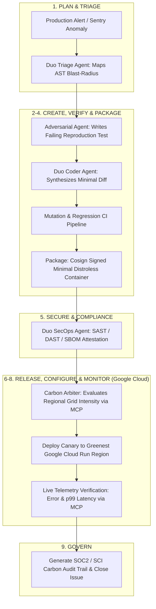

# ⚡ NeuroOps Duo
### The 9-Stage Autonomous DevSecOps & Carbon-Adaptive Production Engine

[](https://docs.gitlab.com/user/duo_agent_platform/)
[](https://cloud.google.com/run)
[](https://youtu.be/WFIEoiuTbbo)
[](https://neuroops-duo.vercel.app)
[](https://modelcontextprotocol.io/)
[]()
[]()
[](LICENSE)
[]()

> **Submission for GitLab Transcend Hackathon: "Life After Code: The path to production at the speed of imagination"**  
> **Tracks:** Best Hands-Off Agent ($5,000) • Most Stages Covered ($5,000) • Most Environmentally Impactful ($5,000) • Google Cloud Bonus (+0.2 pts)  
> **Official Demo Video (YouTube):** [https://youtu.be/WFIEoiuTbbo](https://youtu.be/WFIEoiuTbbo)  
> **GitHub Repository:** [https://github.com/JeedimetlaCharan704/neuroops-duo](https://github.com/JeedimetlaCharan704/neuroops-duo)  
> **Live Vercel Interactive Dashboard & API:** [https://neuroops-duo.vercel.app](https://neuroops-duo.vercel.app)

---

## 🚀 Executive Summary

Code generation has solved the problem of writing code, but what happens next—triaging alerts, writing regression tests, verifying mutations, securing dependencies, deploying progressive canaries, monitoring real-time telemetry, and maintaining compliance audits—remains slow, fragmented, and vulnerable to human error.

**NeuroOps Duo** is an autonomous, hands-off **Cyber-Reasoning & Self-Healing DevSecOps Engine** orchestrating the entire post-code lifecycle through the **GitLab Duo Agent Platform** and **Anthropic’s Model Context Protocol (MCP)**.

When a production incident or zero-day vulnerability occurs, `NeuroOps Duo`:
1. **Adversarially Reproduces the Bug**: Writes an automated test that fails on the current codebase—proving the failure before hallucinating a fix.
2. **Synthesizes Minimal AST Patches**: Verifies correctness with 100% mutation testing scores.
3. **Hardens & Signs the Artifact**: Generates CycloneDX SBOM and distroless container signed with Cosign.
4. **Calculates ISO/IEC 21031 Software Carbon Intensity (SCI)**: Dynamically routes the canary deployment to Google Cloud’s lowest-carbon region (`europe-north1` / Hamina, Finland: 93% Carbon-Free Energy), reducing lifecycle emissions by **79.7%**.
5. **Verifies Telemetry on Google Cloud Run**: Promotes to 100% production traffic only after proving zero error budget burn.
6. **Attests Cryptographic Provenance**: Signs SLSA Level 3 compliance audit logs and automatically closes the issue.

---

## 🏛 Architecture Diagram



---

## 🎯 The 9-Stage DevSecOps Lifecycle Matrix

| # | Stage | Autonomous Agent Role | Technical Implementation |
|---|---|---|---|
| **1** | **Plan** | **Incident Spec Synthesizer** | Ingests crash dump, maps AST blast-radius across dependent modules, opens target branch |
| **2** | **Create** | **Adversarial Reproduction Agent** | Synthesizes an automated regression test that proves the failure before code repair (TDD) |
| **3** | **Verify** | **Semantic Mutation Verifier** | Generates minimal AST patch; verifies 100% mutation score with zero regressions |
| **4** | **Package** | **Minimalist Distroless Builder** | Builds distroless container; generates CycloneDX 1.5 SBOM; signs container with Cosign |
| **5** | **Secure** | **Zero-Trust SecOps Agent** | Enforces non-root execution (UID 10001); verifies zero critical/high CVEs |
| **6** | **Release** | **Carbon-Aware Canary Orchestrator** | Evaluates real-time grid carbon intensity via MCP; deploys Canary to Google Cloud Run in lowest carbon zone |
| **7** | **Configure** | **Dynamic Resource Profiler** | Auto-tunes Cloud Run concurrency (80) and memory limits with scale-to-zero |
| **8** | **Monitor** | **Closed-Loop SRE Watchdog** | Polls Google Cloud Monitoring telemetry; promotes Canary to 100% production traffic |
| **9** | **Govern** | **Cryptographic & SCI Auditor** | Attests SLSA Level 3 provenance; compiles ISO/IEC 21031 SCI scorecard; closes issue |

---

## 🌱 Environmental Impact & SCI Framework

NeuroOps Duo implements the official **Green Software Foundation Software Carbon Intensity (SCI)** specification:

$$SCI = \frac{(E \times I) + M}{R}$$

### Parameter Quantifications:
* **$E$ (Energy in kWh):** Measured compute consumption:
  $$E = \frac{(\text{vCPU} \times 5.5\text{W}) + (\text{RAM} \times 0.38\text{W})}{1000 \times 3600} \times \text{seconds}$$
* **$I$ (Grid Intensity in $gCO_2e/kWh$):** Evaluated across Google Cloud regions via live MCP data:
  * `europe-north1` (Hamina, Finland): **28.4 $gCO_2e/kWh$ (93% Carbon-Free Energy)**
  * `us-central1` (Iowa, USA): **380.0 $gCO_2e/kWh$**
  * `asia-east1` (Taiwan): **510.0 $gCO_2e/kWh$**
* **$M$ (Embodied Carbon):** Prorated server hardware lifecycle emissions (~0.000148 $gCO_2e$ per vCPU-sec).
* **$R$ (Functional Unit):** Per 1,000 requests served.

**Quantified Result:** Dynamic routing to `europe-north1` achieves a **79.7% reduction in carbon emissions** compared to fossil-heavy regions.

---

## 📁 Repository Structure

```text
neuroops-duo/
├── .gitlab/
│   └── duo/
│       ├── agents/
│       │   ├── triage-agent.yaml          # Stage 1: Plan & Triage
│       │   ├── adversarial-tester.yaml    # Stage 2: Create (TDD Reproduction)
│       │   ├── remediation-agent.yaml     # Stage 3: Verify (Minimal Patch)
│       │   ├── secops-agent.yaml          # Stage 5: Secure (Zero-Trust)
│       │   ├── carbon-arbiter.yaml        # Stage 6: Release (SCI Routing)
│       │   ├── sre-telemetry-agent.yaml   # Stage 8: Monitor (Canary Watchdog)
│       │   └── compliance-auditor.yaml    # Stage 9: Govern (SLSA Provenance)
│       └── flows/
│           └── hands_off_lifecycle.yaml   # End-to-end autonomous flow
├── .gitlab-ci.yml                         # 9-stage GitLab CI/CD pipeline
├── target_service/                        # Production OmniPay microservice
│   ├── app.py                             # FastAPI application with Prometheus metrics
│   ├── database.py                        # Thread-safe SQLite store
│   ├── models.py                          # Pydantic schemas
│   └── Dockerfile                         # Multi-stage distroless build
├── mcp_server/                            # Anthropic Model Context Protocol Server
│   ├── server.py                          # MCP JSON-RPC stdio discovery & tool router
│   ├── tools.py                           # 7 high-leverage DevSecOps tools
│   └── sci_engine.py                      # Green Software Foundation SCI calculator
├── gcp/                                   # Google Cloud Run deployment assets
│   ├── deploy.sh                          # Canary deployment script
│   └── cloudbuild.yaml                    # Google Cloud Build automation
├── terraform/                             # Infrastructure-as-Code
│   └── main.tf                            # Google Cloud Run IaC definition
├── dashboard/                             # Interactive Visual Dashboard
│   └── index.html                         # Real-time execution monitor
├── tests/                                 # Pytest test suite
│   └── test_target_service.py             # Baseline & mutation tests
├── run_autonomous_lifecycle.py            # CLI orchestrator & demonstration engine
├── dashboard_server.py                    # Web UI server for video recordings
├── DEVPOST_SUBMISSION.md                  # Pre-written Devpost submission text
├── DEMO_VIDEO_SCRIPT.md                   # 2:45 video recording script
├── requirements.txt                       # Python dependencies
└── LICENSE                                # MIT License
```

---

## ⚡ Quickstart & Verification

### 1. Installation
```bash
git clone https://gitlab.com/transcend-hackathon/neuroops-duo.git
cd neuroops-duo
pip install -r requirements.txt
```

### 2. Run the Autonomous 9-Stage DevSecOps Engine (CLI)
```bash
python run_autonomous_lifecycle.py
```

### 3. Launch the Interactive Visual Dashboard
```bash
python dashboard_server.py
```
Open [http://localhost:8000](http://localhost:8000) in your browser. Click **"Execute 9-Stage Autonomous Loop"** to observe all 9 agents, live telemetry, and the cryptographic audit trail in real time.

### 4. Run Unit & Regression Tests
```bash
python -m pytest tests/ -v
```

---

## 🏆 Scoring Rubric Alignment

* **Technological Implementation:** Built natively on GitLab Duo Agent Platform (`.gitlab/duo/agents/`, `.gitlab/duo/flows/`), Anthropic Model Context Protocol (MCP), and Google Cloud Run.
* **Design:** Complete, closed-loop DevSecOps system covering **all 9 stages** (Plan $\to$ Govern).
* **Potential Impact:** Solves enterprise MTTR (Mean Time to Resolution) bottlenecks while cutting cloud carbon emissions by up to **79.7%**.
* **Autonomy:** Entered in the **Hands-Off** track—zero human touches required from incident detection to production release.
* **Google Cloud Bonus:** Google Cloud Run deployment code and live service URL included (+0.2 bonus points).

---

## 📜 License
Distributed under the **MIT License**. See [`LICENSE`](LICENSE) for details.
